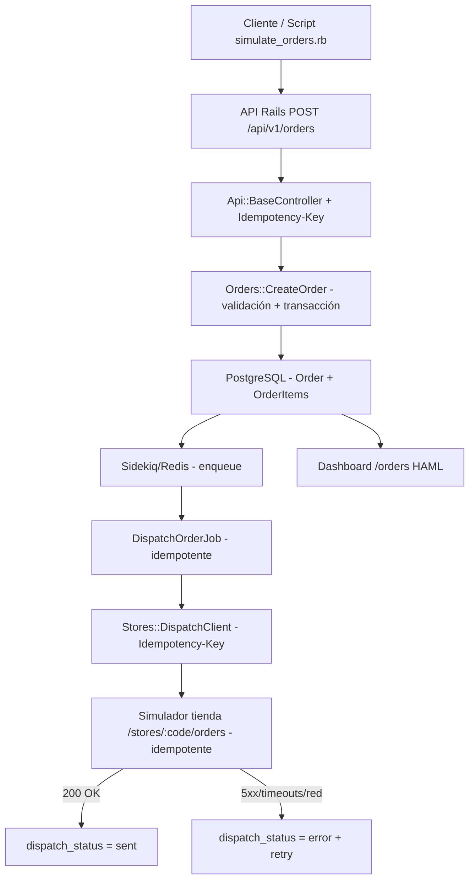
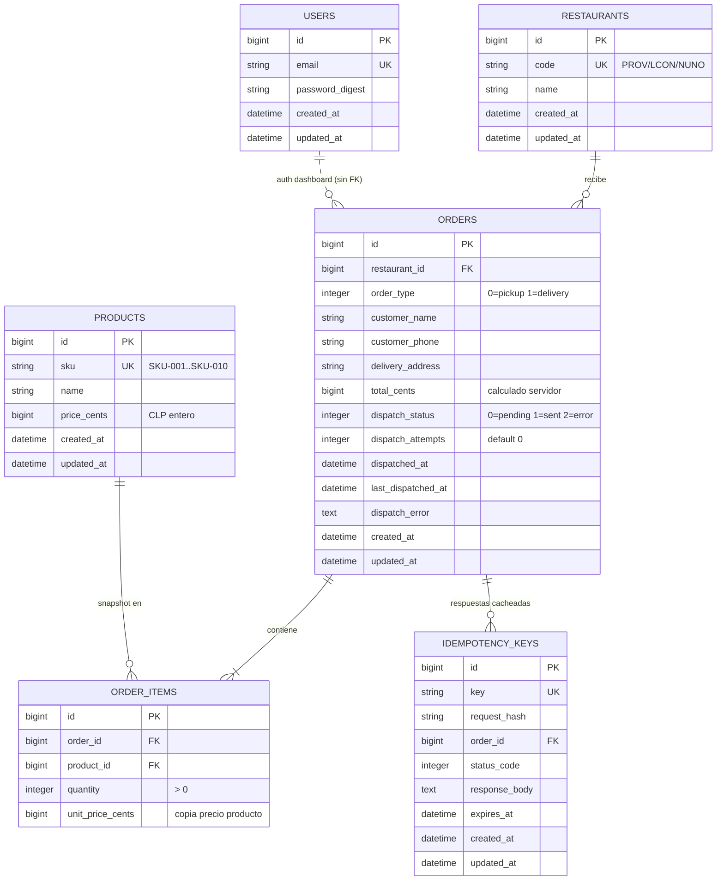

# Arquitectura y diseño de base de datos

## Flujo de una orden (alto nivel)

## Diseño de base de datos (ER)

## Explicación de tablas

- **restaurants**: Tiendas destino. `code` único (usado por el simulador).
- **products**: Catálogo global compartido entre restaurantes.
- **orders**: Cabecera de orden. `total_cents` siempre calculado desde `order_items` (nunca se confía en lo que envíe el cliente). `dispatch_status` controla el envío a tienda. `dispatch_attempts` y `last_dispatched_at` para trazabilidad.
- **order_items**: Detalle con `unit_price_cents` copiado al crear el item (snapshot). Garantiza integridad histórica.
- **users**: Solo para autenticación del dashboard por sesión/cookies. No se relaciona con órdenes.
- **idempotency_keys**: Cache de respuestas para peticiones idempotentes a la API (header `Idempotency-Key`), con hash del request y TTL.

## Decisiones clave

- **Snapshot de precio**: Evita que cambios futuros de precio afecten órdenes ya registradas.
- **Cálculo server-side**: Crítico para integridad (criterio "Integridad").
- **Enums con prefijo**: `order_type_*` / `dispatch_status_*` evitan colisiones.
- **Catálogo global**: Más simple para este dataset; se puede evolucionar a menú por tienda si fuera necesario.
- **User auth-only**: La API es pública según el enunciado.
- **Servicio transaccional**: `Orders::CreateOrder` encapsula creación de orden+items en transacción, cálculo de total y encolado.
- **Idempotencia**: API con `Idempotency-Key` (cacheo + validación de hash), cliente HTTP y job evitan reenvíos duplicados, simulador de tienda idempotente por `order_id`.
- **Reintentos controlados**: Solo ante errores transitorios (red/5xx/timeouts). No se reintenta ante 4xx. Backoff polinómico con `retry_on`.
- **Dashboard con HAML**: Vistas clásicas Rails con badges, paginación `limit/offset`, `includes` para evitar N+1.
- **Simulador de órdenes**: Script Ruby con HTTParty, soporte `API_URL`, `--list`, `--verbose` para generar y enviar órdenes aleatorias.
- **Store headers compatibles con Rack 3**: Headers no congelados, claves en minúsculas.
